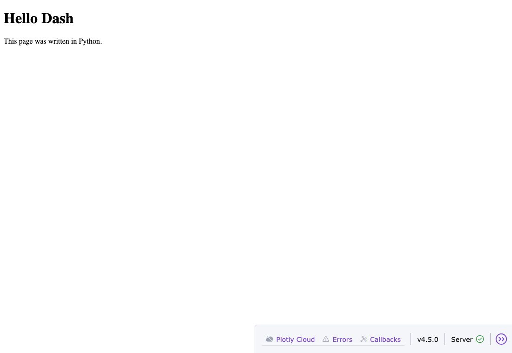
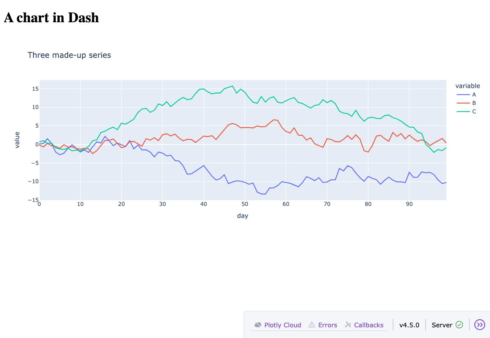
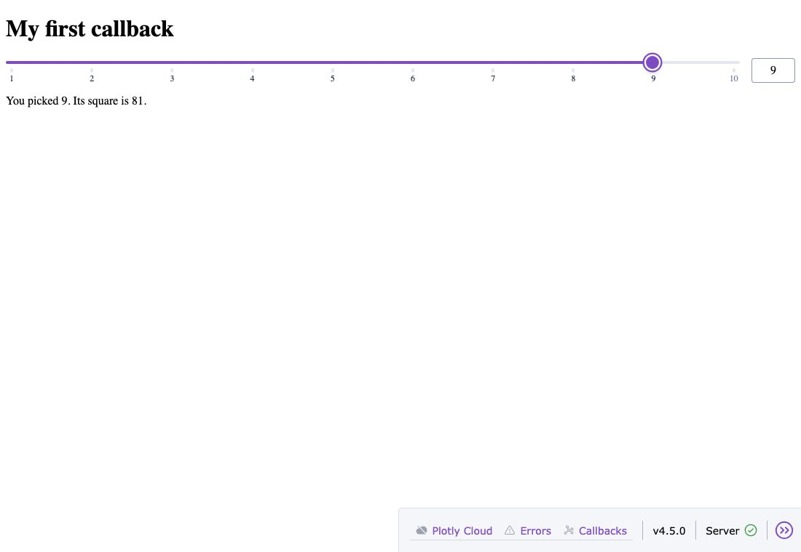
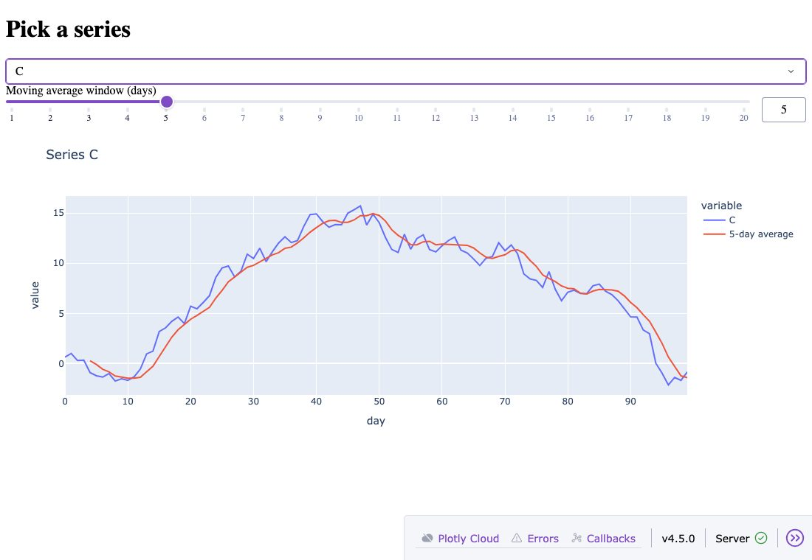
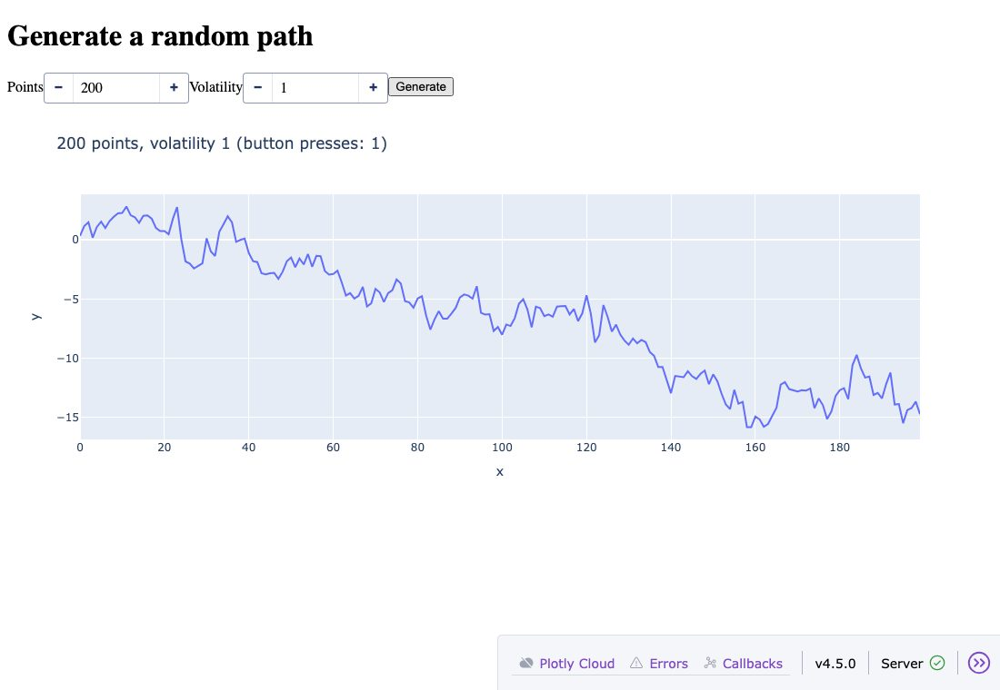
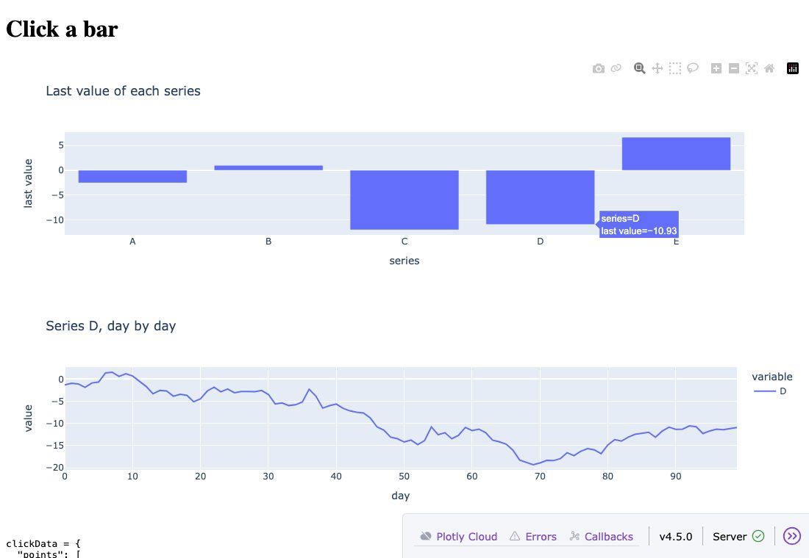
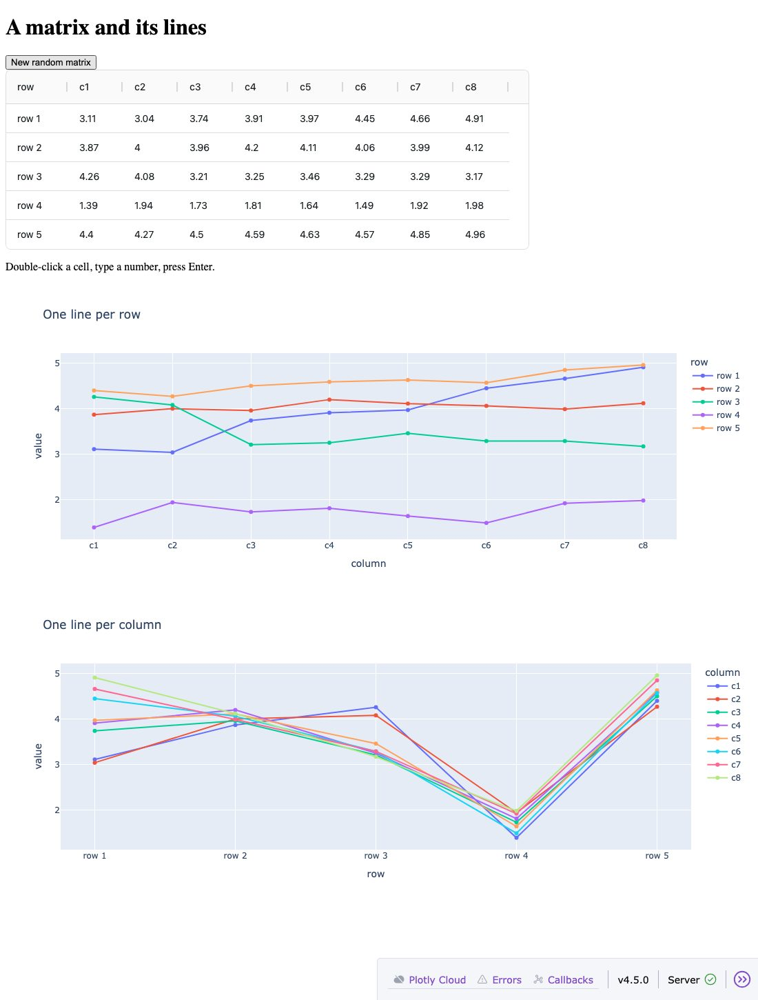
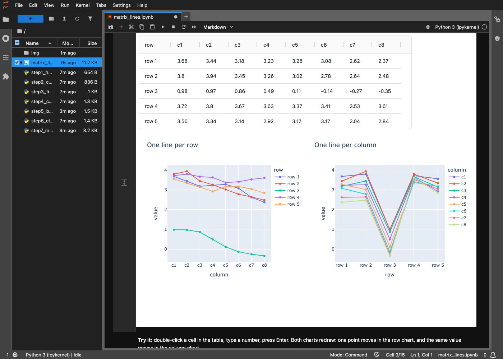

# Dash, step by step

A hands-on guide for someone who has never written a Dash app. Seven small apps, each one adding a single idea to
the one before, then a notebook that ties them together on a data matrix. Every file runs on its own; all the
data is random numbers made up in the code.

| step | file | the new idea |
|---|---|---|
| 1 | `step1_hello.py` | an app and its layout |
| 2 | `step2_chart.py` | a Plotly chart on the page (`dcc.Graph`) |
| 3 | `step3_first_callback.py` | a callback: an input changes, Python runs, the page changes |
| 4 | `step4_chart_callback.py` | a callback that returns a chart; two inputs |
| 5 | `step5_button_state.py` | wait for a button: `State` and `PreventUpdate` |
| 6 | `step6_click_chart.py` | click one chart to drive another (`clickData`) |
| 7 | `step7_matrix.py` | an editable matrix; two charts redraw when it changes; callbacks that chain |
| | `matrix_lines.ipynb` | the matrix app inside a Jupyter notebook; change the data from Python and the charts follow |
| 9 | (your own app) | build with GitHub Copilot in VS Code, and check what it wrote |

Plan on about an hour. Type the code yourself if you can, rather than only running the files: typing it is how
the pieces stick.

## 0. Setup

You need Python 3.10 or newer and a terminal. From the repo root:

```bash
python -m venv .venv
source .venv/bin/activate            # Windows: .venv\Scripts\activate
pip install -r requirements.txt
cd tutorial
```

Then, for every step:

```bash
python step1_hello.py
```

and open **http://127.0.0.1:8050** in a browser. The terminal shows `Dash is running on http://127.0.0.1:8050/`
and stays busy: the app is a small web server, and it runs until you press **Ctrl+C**. Stop one step before you
start the next (they all use port 8050).

All the apps run with `debug=True`, which gives you two things:

* **Auto reload:** save the file and the page reloads with your change. You rarely need to restart.
* **Dev tools:** the small bar at the bottom right of the page. **Errors** shows Python errors from your
  callbacks; **Callbacks** draws a diagram of which component feeds which callback.

## 1. An app and its layout (`step1_hello.py`)

```python
from dash import Dash, html

app = Dash(__name__)

app.layout = html.Div([
    html.H1("Hello Dash"),
    html.P("This page was written in Python."),
])

if __name__ == "__main__":
    app.run(debug=True)
```



* `app = Dash(__name__)` makes the app.
* `app.layout` is what the page shows. It is built from **components**, Python objects that become HTML
  elements: `html.H1` is a heading, `html.P` a paragraph, `html.Div` a box that holds others. They nest like
  boxes, and the order in the code is the order on the page.
* `app.run(debug=True)` starts the server.

**Try:** add `html.P("A second paragraph")` to the list and save. The page reloads by itself.

## 2. A chart (`step2_chart.py`)

```python
fig = px.line(df, title="Three made-up series")     # an ordinary Plotly figure

app.layout = html.Div([
    html.H1("A chart in Dash"),
    dcc.Graph(figure=fig),
])
```



* `px.line(df)` draws one line per column of a DataFrame, with the index on the x axis.
* `dcc.Graph(figure=fig)` puts a Plotly figure on the page. `dcc` holds Dash's interactive components:
  graphs, dropdowns, sliders, inputs.
* Zoom, pan and hover work, because Plotly runs them in the browser. But the figure was built once, when the
  script started. Nothing on the page can change it yet.

**Try:** change `px.line` to `px.area`, save, and look.

## 3. The first callback (`step3_first_callback.py`)

This is the step that makes Dash an *app* rather than a page.

```python
app.layout = html.Div([
    html.H1("My first callback"),
    dcc.Slider(1, 10, 1, value=3, id="n"),
    html.P(id="msg"),
])


@app.callback(Output("msg", "children"), Input("n", "value"))
def show(n):
    print("show() called with n =", n)
    return f"You picked {n}. Its square is {n * n}."
```



Read the callback as a sentence: *when the `value` of component `n` changes, call `show` with it, and put what it
returns into the `children` of component `msg`.*

* Every component a callback uses needs an **`id`**, a name you choose.
* **`Input(id, property)`** names what to watch. A slider's chosen number is its `value`.
* **`Output(id, property)`** names where the result goes. `children` is what is inside a component, here the
  text of the paragraph.
* `@app.callback(...)` is a decorator: it registers `show` with Dash. You never call `show` yourself; Dash calls it.
* Dash also calls it **once when the page loads**, to fill `msg` the first time. That is the first line you see
  in the terminal.

Move the slider and watch the terminal: a new line for every move. The function runs in Python on the server.
The browser sends the new value, Python runs `show`, and the browser puts the answer on the page.

**Try:** return `n * n * n` instead and save. Then change `Input("n", "value")` to `Input("n", "wrong")` and save:
the **Errors** button at the bottom right explains what went wrong. Put it back.

## 4. A callback that draws a chart (`step4_chart_callback.py`)

```python
@app.callback(Output("chart", "figure"),
              Input("series", "value"),        # -> first argument
              Input("window", "value"))        # -> second argument
def draw(series, window):
    d = pd.DataFrame({series: df[series],
                      f"{window}-day average": df[series].rolling(window).mean()})
    return px.line(d, title=f"Series {series}")
```



* The Output is now the `figure` of a `dcc.Graph`, so the function returns a figure.
* There are **two Inputs**. The function gets their values **in the order the Inputs are listed**: the dropdown's
  value first, then the slider's. A change to either one runs the function, with the current values of both.
* `dcc.Graph(id="chart")` starts with no figure; the callback fills it when the page loads.

**Try:** add a third series `"D"` to the DataFrame and to the dropdown's list.

## 5. Wait for a button (`step5_button_state.py`)

Sometimes you want to set several things and *then* run, for example before a slow computation.

```python
@app.callback(Output("chart", "figure"),
              Input("go", "n_clicks"),
              State("points", "value"),
              State("vol", "value"))
def generate(n_clicks, points, vol):
    if points is None or vol is None:
        raise PreventUpdate
    ...
```



* A button's **`n_clicks`** counts how many times it has been pressed. Every press changes it, so as an Input it
  means "run when pressed".
* **`State`** passes a value in without running the callback when it changes. Type in the boxes: nothing
  happens. Press Generate: the chart uses what you typed.
* A number box gives `None` when it is empty or out of range (try `5` points: the minimum is 10).
  **`raise PreventUpdate`** stops the callback and leaves the page as it was.
* The arguments are still in order: all Inputs first, then all States.

## 6. Click one chart to drive another (`step6_click_chart.py`)

```python
@app.callback(Output("detail", "figure"),
              Output("raw", "children"),
              Input("bars", "clickData"))
def detail(click):
    series = "A" if click is None else click["points"][0]["x"]
    ...
```



* A `dcc.Graph` has properties that **the browser fills in** as you use the chart: `clickData` (the point
  clicked last), `hoverData`, `selectedData` (box or lasso), `relayoutData` (zoom). Use them as Inputs like
  any other property.
* `clickData` is `None` until the first click; then it is a dict whose `points` list holds the clicked point.
  The app prints it under the charts, so you can see what is inside.
* **Two Outputs:** the function returns two values, in the order the Outputs are listed.

**Try:** change `Input("bars", "clickData")` to `Input("bars", "hoverData")`. Now the bottom chart follows the
mouse.

## 7. A matrix and two charts that follow it (`step7_matrix.py`)

A 5 x 8 matrix in an editable table, and two line charts:

* **one line per row**: the x axis is the columns. `px.line(df.T)`: the transpose turns rows into columns.
* **one line per column**: the x axis is the rows. `px.line(df)`.



The table is an AG Grid (`dash_ag_grid.AgGrid`, installed by `requirements.txt`). Its **`rowData`** property is
the matrix as a list of dicts, one per row:

```python
[{"row": "row 1", "c1": 3.68, "c2": 3.44, ...}, {"row": "row 2", ...}, ...]
```

`to_rows` turns a DataFrame into that list, and `to_frame` turns it back. There are two callbacks:

```python
@app.callback(Output("grid", "rowData"), Input("new", "n_clicks"), prevent_initial_call=True)
def new_matrix(n_clicks):
    return to_rows(random_matrix(n_clicks))


@app.callback(Output("by-row", "figure"),
              Output("by-col", "figure"),
              Input("grid", "rowData"),
              Input("grid", "cellValueChanged"))
def draw(rows, edit):
    df = to_frame(rows)
    return px.line(df.T, ...), px.line(df, ...)
```

* **Callbacks chain.** The button runs `new_matrix`, whose Output is the grid's `rowData`. That is an Input of
  `draw`, so `draw` runs next. You never call one callback from another; Dash follows the ids. Open
  **Callbacks** in the dev tools to see the chain drawn.
* **Edits.** Double-click a cell, type a number, press Enter. The grid updates `rowData` and announces the edit
  through `cellValueChanged` (which cell, the old and the new value). `draw` listens to it, so both charts
  redraw. The one number you changed moves in both charts.
* **`prevent_initial_call=True`** skips the call on page load: the grid already has its first matrix.

**Try:** add a third chart, a heatmap of the matrix (`px.imshow(df)`), as a third Output of `draw`.

## 8. The same matrix in a notebook (`matrix_lines.ipynb`)

```bash
jupyter lab matrix_lines.ipynb        # or open the file in VS Code
```

Run the cells in order (Shift+Enter). The notebook:

* **A.** builds the matrix as a DataFrame and draws the two charts with Plotly alone. They are snapshots: change
  the matrix and they stay as they were.
* **B.** runs the step 7 app **inside the notebook**, under the cell (`app.run(jupyter_mode="inline")`). The cell
  finishes at once; the app keeps running in the background.
* **C.** changes the matrix **from Python**: `live.set(new_matrix)` in a notebook cell, and the charts in the app
  above redraw within half a second. Edits made in the app's table come back too: `live.df` holds them.



How does a notebook cell reach the page? It can't directly: a web page asks the server, and the server cannot
push to it. So the page **polls**. A `dcc.Interval` fires every 500 ms and runs a callback that compares a
version number (`live.version`, increased by every `live.set`) with the version the page last showed. If they
differ, it sends the new matrix to the table, and the table's new `rowData` runs `draw`, as in step 7. The same
pattern refreshes an app from any data that changes outside it: a file, a database table.

## 9. Building with GitHub Copilot in VS Code

Most new Dash code is now written with an AI assistant, and in VS Code that is GitHub Copilot. Steps 1 to 8 are
what you need to **read** what it writes. Copilot writes better Dash when it is given rules and a way to check its
work. Start with what Plotly and the community already provide.

**Start here**

| resource | what it gives you |
|---|---|
| [Using Dash with AI coding assistants](https://dash.plotly.com/ai-coding-assistants) (Plotly) | the main one: a template rules file for agents and a list of Dash practices (current API, callbacks, state, charts). Copy the parts you need. Some sections are about Plotly's paid products and hosting; skip those if you don't use them |
| [Dash docs for AI tools](https://dash.plotly.com/llms.txt) (Plotly) | an index of every docs page. Add `.md` to any docs address (for example `https://dash.plotly.com/basic-callbacks.md`) to get the page as plain text, ready to paste into a chat |
| [awesome-copilot](https://github.com/github/awesome-copilot) (GitHub, community) | a large collection of Copilot instructions, prompts and skills. Nothing Dash-specific yet, but useful general ones (security, testing, Python tooling). Read a file before adding it: it is instructions Copilot will follow |
| [awesome-dash](https://github.com/ucg8j/awesome-dash) (community) | a curated list of Dash component libraries, example apps and tutorials |
| [Plotly community forum](https://community.plotly.com/) | questions and answers; search your error message here first |
| VS Code docs: [custom instructions](https://code.visualstudio.com/docs/copilot/customization/custom-instructions), [prompt files](https://code.visualstudio.com/docs/copilot/customization/prompt-files), [agent skills](https://code.visualstudio.com/docs/agent-customization/agent-skills) | how Copilot finds and uses the files below |

**What this repo adds**

Plotly's rules, condensed into Copilot's file format, plus a few things we found useful when testing:

| file | when Copilot uses it | what it holds |
|---|---|---|
| `.github/copilot-instructions.md` | every chat request, automatically | Plotly's Dash rules, each section linked to its source, plus a handful of checked additions (for example: editable AG Grids need `cellValueChanged`; `clickData` is `None` before the first click) |
| `.github/skills/dash-app/` | when a request is about a Dash app, or when you type `/dash-app` | a short workflow (plan the callbacks, write, check, report) and `check_app.py`, a checker that needs no browser |
| `.github/prompts/` | when you type `/new-dash-app`, `/explain-callbacks` or `/fix-dash-error` | three ready-made requests |

All of it is plain text: copy `.github/` into your own project to use it there, and edit it to taste.

**Set up once**

1. Install the **GitHub Copilot** and **GitHub Copilot Chat** extensions in VS Code and sign in.
2. Open the **repo root** as the folder (File > Open Folder): Copilot reads `.github/` at the root of the open
   folder.
3. Pick the Python interpreter from `.venv` (Command Palette > *Python: Select Interpreter*), so the terminal
   Copilot uses has Dash installed.
4. Open the Chat view and choose **Agent** in the mode picker, so Copilot can create files and run commands.
   It asks before running a command; read the command, then allow it.

**Build an app**

Type `/new-dash-app` and describe the app, or ask in plain words, for example:

> Build me a small Dash app in my_app.py: a heatmap of a random 6x6 matrix, a slider for the noise level, and a
> button that draws a new random matrix.

You should get back the file, a PASS from the checker, the wiring, and the command to run the app. If Copilot
skips the check or the wiring, ask: "Run the dash-app checker and show me the wiring."

**Check it yourself.** The checker works on any Dash app, yours or Copilot's, from the repo root:

```bash
python .github/skills/dash-app/check_app.py my_app.py
```

```
PASS  my_app.py
      Input(new-matrix.n_clicks) -> Output(matrix-store.data)
      Input(noise.value), Input(matrix-store.data) -> Output(heatmap.figure)
```

It imports the app without starting a server, checks that every id used by a callback exists in the layout,
runs every callback once as the page load does, and prints the wiring. It catches a misspelled id, a callback
that returns one value for two Outputs, and a callback that raises an error. It cannot click, so it does not
test what happens after a click: run the app and try it.

**Then read the wiring.** For each line, ask the questions from steps 3 to 7: what triggers it (Input), what it
only reads (State), where the results go (Output), and does anything chain? If the wiring isn't what you meant,
say so in those terms ("the slider should be a State, not an Input"). `/explain-callbacks` walks through an
existing app the same way, without changing it. When something breaks, copy the text of the red error box from
the dev tools (or the terminal) and use `/fix-dash-error`.

## What you have learned

| term | meaning |
|---|---|
| layout | the page, as a tree of components (`app.layout`) |
| component | a piece of the page: `html.*` for plain HTML, `dcc.*` for interactive parts, `dash_ag_grid.AgGrid` for tables |
| `id` | the name you give a component so a callback can find it |
| property | a value a component holds: `value`, `children`, `figure`, `n_clicks`, `clickData`, `rowData` |
| callback | a function Dash calls when an Input changes; its return values go to the Outputs |
| `Input` | runs the callback when it changes; its value is passed in |
| `State` | its value is passed in, but it does not run the callback |
| `Output` | where a returned value goes |
| `PreventUpdate` | stop without changing the page |
| `prevent_initial_call` | don't run when the page loads |
| `dcc.Interval` | a timer: its `n_intervals` goes up on every tick, so it can drive a callback |
| `dcc.Store` | keeps a value in the page (not shown), for callbacks to read and write |

## When something goes wrong

| what you see | why, and the fix |
|---|---|
| `Address already in use` / port 8050 is taken | an earlier app is still running. Stop it with Ctrl+C in its terminal, or run on another port: `app.run(debug=True, port=8051)` |
| a `print` at the top of the script (outside any function) shows twice in the terminal | normal with `debug=True`: the auto-reloader runs the file in a second process |
| the page says a component id was not found | the `id` in `Input`/`Output` doesn't match any `id` in the layout. Check the spelling |
| the callback runs but nothing changes | the property name is wrong (`"values"` instead of `"value"`), or the function returns the wrong kind of thing (a number where a figure is expected) |
| a red error bubble at the bottom right | click it: it shows the Python traceback from your callback |
| more Outputs than returned values (or fewer) | a callback with two Outputs must return two values, in the same order |
| the notebook shows no app under the cell | run the cells from the top; check that port 8060 is free, or change `port=` in the app cell |

## Where to go next

* `../demos/03_widgets.py` shows every common input component at once; `../demos/components/` has one tiny app
  per component, each with its callback.
* `../demos/05_click_detail.py` is step 6 with real-looking (still synthetic) data.
* The official Dash tutorial and component reference: https://dash.plotly.com/tutorial
